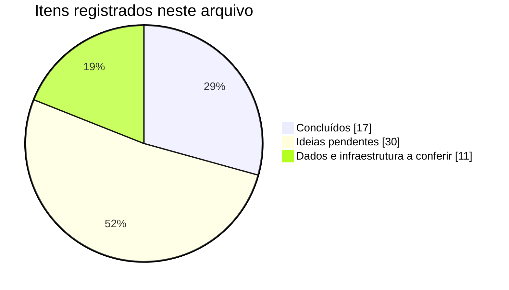

# Pendências, ideias e progresso

Registro do que já foi feito no site e do que ainda pode ser implementado. Nada aqui foi inventado: os itens de dados dependem de conferência com as fontes originais.

_Atualizado em 18/10/2026._

## Progresso geral

| Grupo | Concluído | Progresso |
|---|---:|---|
| Revisões e entregas (fora da lista de ideias) | 11 de 11 | `████████████████████` 100% |
| Ideias de melhoria | 4 de 34 | `██░░░░░░░░░░░░░░░░░░` 12% |
| Dados a conferir | 1 de 8 | `██░░░░░░░░░░░░░░░░░░` 12% |
| Funcionalidades e infraestrutura | 1 de 5 | `████░░░░░░░░░░░░░░░░` 20% |
| **Total** | 17 de 58 | `██████░░░░░░░░░░░░░░` 29% |

**Ideias de melhoria por grupo**

| Grupo | Concluído | Progresso |
|---|---:|---|
| Prioritárias | 0 de 5 | `░░░░░░░░░░` 0% |
| Conteúdo | 2 de 8 | `██░░░░░░░░` 25% |
| Ferramentas (/web) | 0 de 3 | `░░░░░░░░░░` 0% |
| Contato e networking | 0 de 2 | `░░░░░░░░░░` 0% |
| Navegação e experiência | 2 de 6 | `███░░░░░░░` 33% |
| Automação de dados | 0 de 2 | `░░░░░░░░░░` 0% |
| Visibilidade | 0 de 4 | `░░░░░░░░░░` 0% |
| Qualidade automática | 0 de 4 | `░░░░░░░░░░` 0% |

## ✅ Já feito

1. Revisão completa do site: estrutura, conteúdo do Lattes, versões PT/EN/ES, SEO, acessibilidade (WCAG 2.1 AA) e segurança (CSP)
2. Gerador estático `_src/build.py` (dados em JSON, páginas nos três idiomas, sitemap e verificação de links)
3. Aviso de consentimento do Google Analytics (o GA só carrega após "Aceitar")
4. Diretório /web (Ferramentas) refeito com o mesmo design, sem build em Python, preservando Assinatura e Custom Plate
5. Publicações e produção simplificadas (título, revista e DOI/link); autores removidos do site e dos JSON
6. Data de atualização removida do rodapé
7. Versão impressa corrigida (sem sombras, cores legíveis, seções expansíveis abertas)
8. Nova página "Vida de cientista" com animações, apresentação automática e galeria
9. Novo design da página Premiações (resumo calculado e linha do tempo por ano)
10. Página Design reformulada (sem WebGL, segue o tema, paleta atualizada, textos de Tipografia e Logo revisados)
11. Aviso de idioma discreto, conforme o idioma do navegador, sem redirecionamento _(ideia I19)_
12. Tema com três opções: claro, escuro e seguir o sistema _(ideia I20)_
13. Currículo em PDF nos três idiomas, gerado a partir dos JSON (sem foto; datas de geração e de atualização no rodapé) _(ideia I7)_
14. Ferramentas (/web): seletor de tema com três opções, menu com a página atual marcada e novas páginas "Sobre" e "Aviso de uso"

## Ideias de melhoria

Marcadas com ✅ as já implementadas. A numeração continua a da versão anterior deste arquivo (itens 15–28) e acrescenta as ideias novas.

### Prioritárias
- [ ] I1. **Build automático no GitHub (GitHub Actions)**: gerar o site (e os PDFs) a cada alteração em `_src/`, permitindo editar os JSON pelo navegador e bloqueando a publicação se houver erro.
- [ ] I2. **Recursos nas publicações**: botão "Citar" (referência e BibTeX), arquivo `.bib`/`.ris` com tudo, selo de Acesso Aberto e link para o PDF.
- [ ] I3. **Gráficos na página Métricas**: publicações por ano e citações por ano.
- [ ] I4. **Ordenação automática dos artigos por ano** no `build.py`.
- [ ] I5. **Totais da página Métricas calculados automaticamente** a partir dos JSON (hoje são manuais em `cv.json` → `totals`).

### Conteúdo
- [ ] I6. **Seção de Novidades** na página inicial, alimentada por uma lista no JSON.
- [x] I7. ✅ **Currículo em PDF para download** nos três idiomas.
- [ ] I8. **"Vida de cientista" em inglês e espanhol.**
- [ ] I9. **Projeto atual em destaque**, com imagem ou *graphical abstract*.
- [x] I10. ✅ **Logos da UESC e do IF Baiano** na linha do tempo (ver item D7).
- [ ] I11. **Glossário de técnicas** (ICP-MS, ICP OES, FAAS, GFAAS, MIP OES, solventes eutéticos) explicado para leigos.
- [ ] I12. **Mapa de onde a pesquisa aconteceu** (instituições, eventos, coletas), como imagem estática.
- [ ] I13. **Rede de coautores** (gráfico). Exige guardar de novo os autores no JSON, só para o gráfico.

### Ferramentas (/web)
- [ ] I14. **Calculadora de diluições e preparo de soluções** (C₁V₁ = C₂V₂, diluições seriadas, curva de calibração).
- [ ] I15. **Conversor de concentração** (mg L⁻¹, µg L⁻¹, ppm, ppb, mol L⁻¹).
- [ ] I16. **Calculadora de LOD/LOQ e regressão linear** a partir dos pontos da curva.

### Contato e networking
- [ ] I17. **Cartão de visita digital (/cartao)** com QR code e botão "Salvar contato" (vCard).
- [ ] I18. **Botão "Copiar e-mail"** na página Contato, com proteção contra spam.

### Navegação e experiência
- [x] I19. ✅ **Aviso de idioma** discreto, sem redirecionar.
- [x] I20. ✅ **Tema com três opções**: claro, escuro e seguir o sistema.
- [ ] I21. **Busca no site inteiro** (publicações, eventos, prêmios), sem servidor.
- [ ] I22. **Linha do tempo interativa na Biografia**, com movimento suave.
- [ ] I23. **Página 404 mais útil**, com busca e sugestões.
- [ ] I24. **Rótulo de cookies consistente** nos três idiomas (hoje: "Preferências" / "Cookie preferences" / "Preferencias").

### Automação de dados
- [ ] I25. **Métricas automáticas via OpenAlex** (atualização semanal).
- [ ] I26. **Importar publicações do ORCID.**

### Visibilidade
- [ ] I27. **Dados estruturados `ScholarlyArticle`** em cada publicação.
- [ ] I28. **Google Search Console** com envio do `sitemap.xml` (requer login do proprietário).
- [ ] I29. **Imagem de compartilhamento por página e idioma.**
- [ ] I30. **Feed RSS** das publicações e novidades.

### Qualidade automática
- [ ] I31. **Teste de acessibilidade (axe) a cada alteração**, no GitHub Actions.
- [ ] I32. **Verificação semanal de links externos** (DOIs e páginas de editoras).
- [ ] I33. **Relatório de desempenho (Lighthouse)** a cada publicação.
- [ ] I34. **Limpeza do repositório web**: `assets/`, `js/`, `robots.txt` e `components/style.css` sem uso.

## Dados a conferir

- [ ] D1. **Telefone profissional**: o Lattes traz "34 97676100" (8 dígitos após o código do país; números espanhóis têm 9). Não publicado; informe o número correto em `cv.json` → `person`.
- [ ] D2. **Índice h do Scopus e do Google Scholar**: conferir periodicamente nos perfis (valores em `cv.json` → `metrics`).
- [ ] D3. **Artigos sem DOI no Lattes** (ligados à página da editora): Microchemical Journal 2024 (SPR biosensor), J. Food Compos. Anal. 2022, J. Trace Elem. Med. Biol. 2021, Talanta 2021, Analytical Methods 2020 e J. Electroanal. Chem. 2020. Basta preencher `doi` em `publications.json`.
- [ ] D4. **Artigo "Chemometric-assisted classification of sunscreen…"**: consta como aceito; quando sair o volume, mudar `status` para `published`.
- [ ] D5. **Capítulo de 2023 (Seven Editora)**: título no Lattes repete "chemical preservatives" e "State Solid"; conferir com a publicação original.
- [ ] D6. **Pós-doutorado na Embrapa (2024)**: o Lattes não indica a unidade nem o período exato.
- [x] D7. ✅ **Logos da UESC e do IF Baiano**: incluídos (`assets/svg/ifbaiano.svg`; UESC em `assets/img/logos/uesc.webp`, versão leve do `uesc.svg`).
- [ ] D8. **Participação em eventos**: o quadro de totais do Lattes soma 19, mas a lista tem 21 itens (exposição e feira não entram no total).

## Funcionalidades e infraestrutura

- [ ] F1. **Ferramentas (/web/)** ficam em outro repositório (floriatan.com.br/web/). `design-meta.html` depende de arquivos de lá.
- [ ] F2. **Google Analytics e privacidade**: consentimento implementado. Recomendável ainda conferir, no painel do GA, que os "Indicadores do Google" estão desativados e definir a retenção de dados (ex.: 2 meses).
- [ ] F3. **Formulário de contato**: não implementado (o GitHub Pages não processa formulários); o contato é por e-mail.
- [ ] F4. **Arquivos antigos**: `assets/img/cover.png` (duplicata de `assets/cover.png`, usada só em `exemplos.html`) e `assets/img/profile.png` (substituído por `profile.webp`) ainda existem. Os demais arquivos sem uso já foram removidos.
- [x] F5. **Publicação no GitHub**: ✅ resolvido; as alterações são enviadas direto ao repositório.

## Como manter este arquivo

- Ao concluir um item, marque `[x]` e mova a descrição para "Já feito", se for uma entrega relevante.
- O gráfico e as tabelas de progresso refletem as contagens desta página; atualize os números ao marcar itens.
